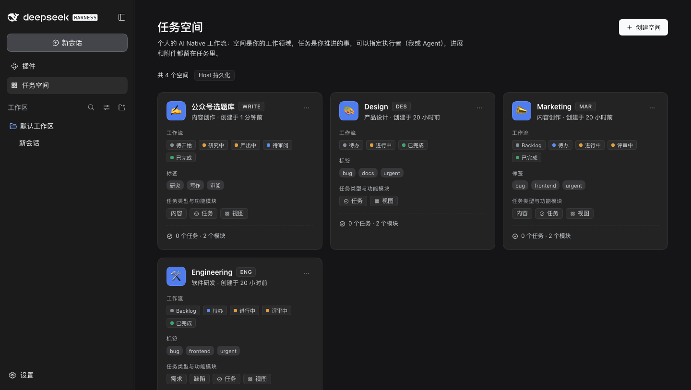
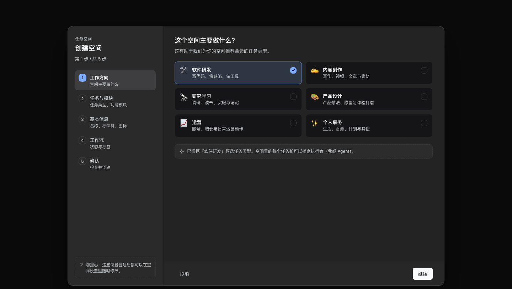
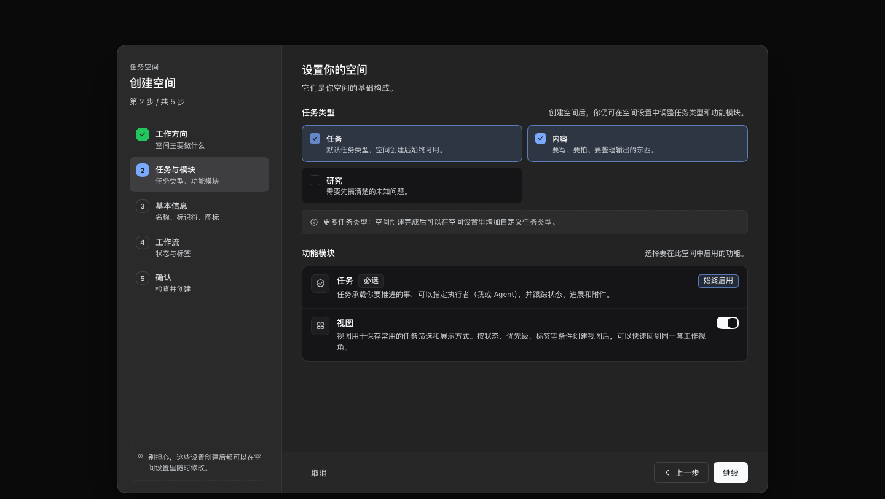
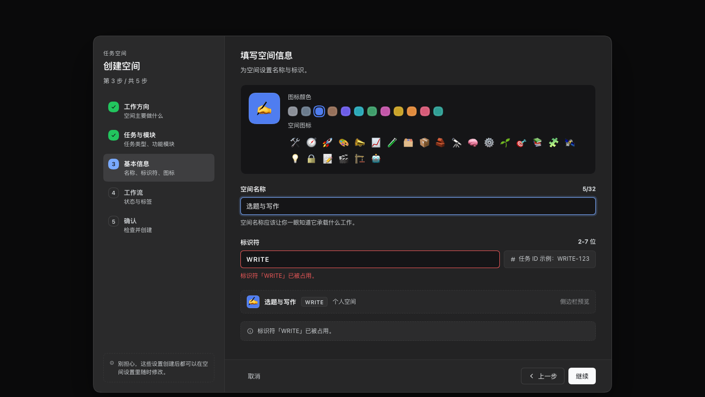
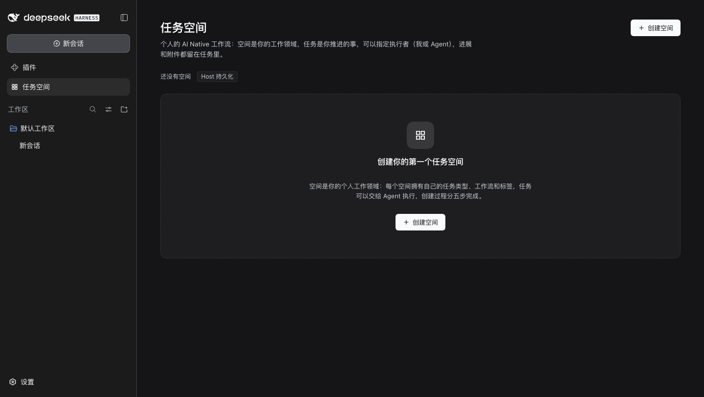
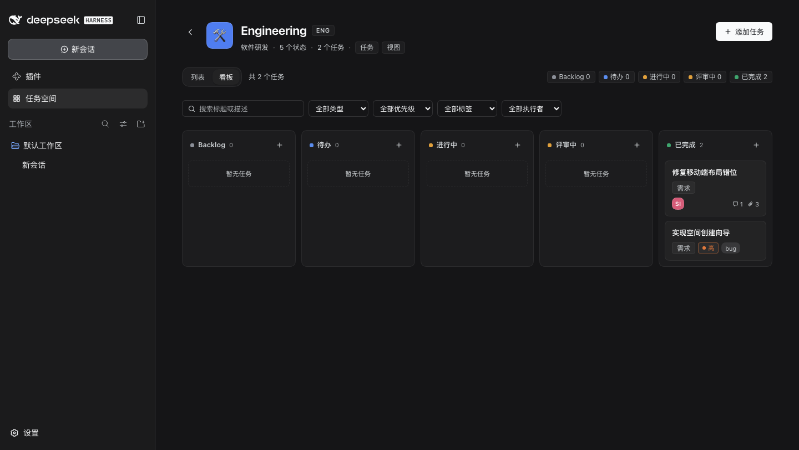
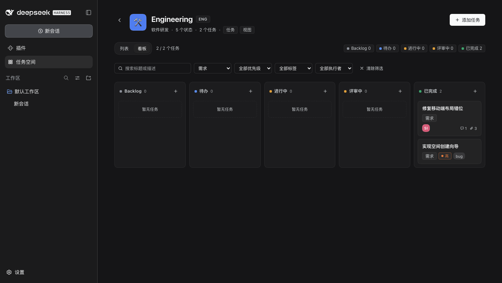
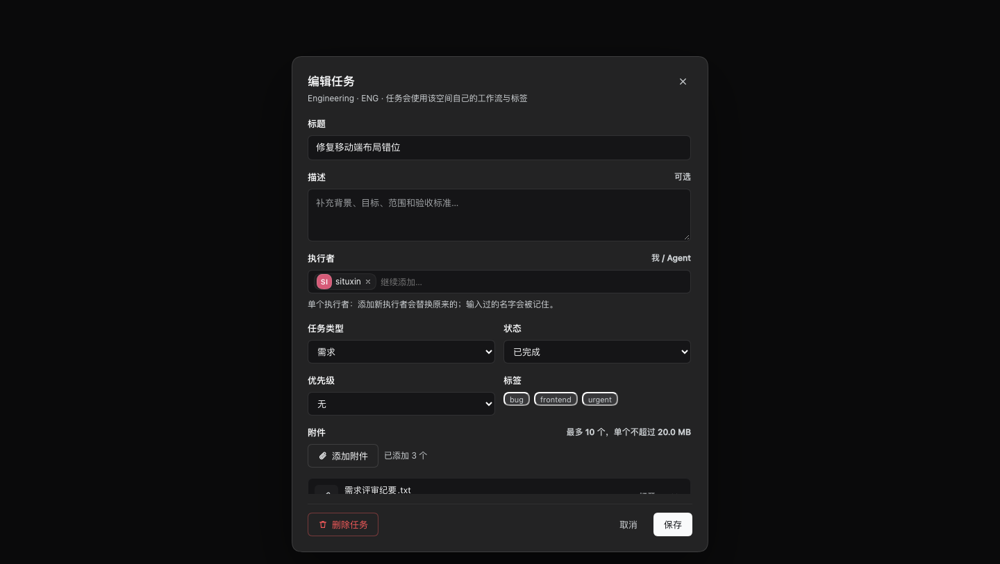
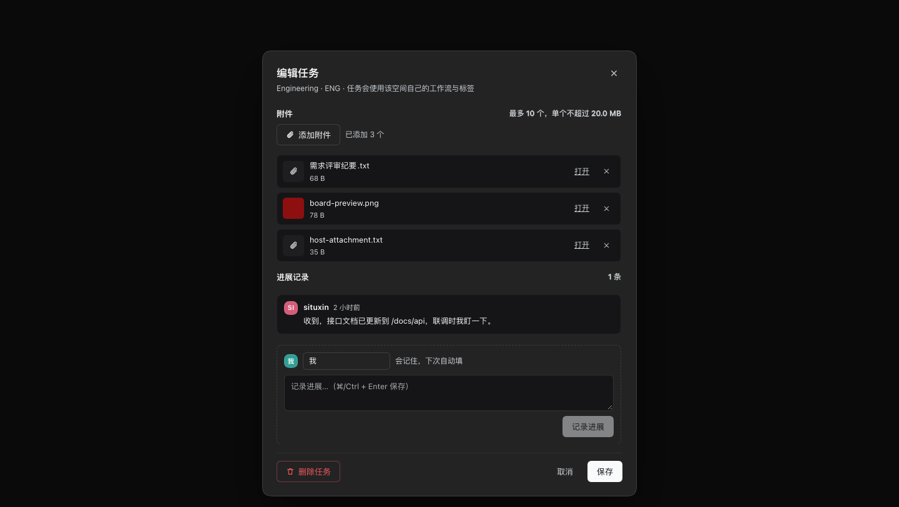

# dsh-plugin-task-spaces

[](https://github.com/SheriSzeto/dsh-plugin-task-spaces/actions/workflows/verify.yml)

**个人的 AI Native 工作流**，做成 DeepSeek Harness Web GUI 的插件：
侧边栏多一个 **任务空间** 面板，用「空间」组织自己的工作领域；每个任务可以指定**执行者（我或 Agent）**，状态、进展记录和附件都沉淀在任务里。数据保存在本机宿主侧，刷新/清浏览器缓存都不会丢。



## 功能

- **侧边栏入口**：`sidebar.panellist` 注册「任务空间」图标；点击切到 `main` 面板的独立页面，和「插件」「会话」互不干扰。
- **空间工作台**：空间卡片展示图标、名称、任务 ID 前缀、工作方向、工作流状态、标签、任务类型与功能模块；卡片菜单（复制设置新建 / 删除空间）和删除二次确认。
- **任务管理**：点击空间卡片进入该空间的工作台，可以 **添加任务**（标题、描述、执行者、任务类型、状态、优先级、标签、附件），用 **列表 / 看板** 两种视图查看，看板按空间自己的工作流状态分列；**看板支持拖拽卡片改状态**（拖到目标列松手即可，列会高亮），点任务可编辑（含改状态、优先级、标签）或删除。空间卡片上实时显示任务数，删除空间会连带删除其任务。
- **任务筛选**：工作台顶部可按 **关键词（标题/描述）、任务类型、优先级、标签、执行者** 组合筛选，列表与看板同时生效，计数显示为 `命中 / 总数`，一键「清除筛选」。
- **执行者与附件**：每个任务有一个**执行者**（输入「我」或 Agent 名称，回车添加，输入过的名字会被记住；再填会替换原来的），也可以添加附件（Host 模式下最多 10 个、单个 ≤ 20 MB；图片显示缩略图，可打开或移除）。列表行与看板卡片显示执行者头像和附件数量。
- **进展记录**：任务弹窗里可以直接记录进展（支持 ⌘/Ctrl + Enter），记录人会被记住，记录**即时保存**、可删除；列表行与看板卡片显示记录条数。进展随任务一起删除。
- **五步创建向导**（`创建空间` 弹窗）：

  
  
  

  | 步骤 | 内容 |
  | --- | --- |
  | 1. 工作方向 | 6 种个人方向（软件研发 / 内容创作 / 研究学习 / 产品设计 / 运营 / 个人事务），决定推荐的任务类型、默认图标 |
  | 2. 任务与模块 | 任务类型多选（任务 / 需求 / 缺陷 / 研究 / 内容，按工作方向推荐默认勾选）；功能模块：任务（必选）、视图 |
  | 3. 基本信息 | 图标 emoji + 12 色底、空间名称（≤32 字，实时计数）、标识符（2-7 位字母数字、同一机器唯一、实时校验并预览 `CODE-123`）、侧边栏效果预览 |
  | 4. 工作流 | 三套个人节奏预设（轻量待办 / 深度工作 / AI 自动化）或「从已有空间复制」；状态可改名、设默认（星标）、增删；标签可增删 |
  | 5. 确认 | 配置摘要（任务类型、模块、工作流、标签、执行方式），最后「创建空间」 |

- **反馈**：创建成功有 toast、新卡片闪光高亮；标识符冲突、名称为空等校验就地提示。
- **Host 侧持久化**：空间 / 任务 / 进展记录 / 附件元数据由**插件宿主半侧**保存到本机 DSH 数据目录 `~/.dsh/task-spaces/data.json`，附件字节保存为真实文件 `~/.dsh/task-spaces/files/<id>`，浏览器通过同源 `/api/task-spaces/...` 读写。**清浏览器站点数据、换浏览器、重启 Harness 都不会丢**；Host 不可用时自动回退到 localStorage（页面顶部会显示「本地模式」）。首次加载会把旧版存在 localStorage 里的数据一次性迁移到 Host。













## 安装

插件已经按包的形式放在这个目录。可以用插件管理器（推荐，会同时写入 profile 依赖与组合包选择）：

```bash
# Web GUI：设置 → 插件，或让 Agent 调用 plugin_manager 工具
# 安装本地路径即可：
#   target: /Users/situxin/Documents/dsh
```

公开发布后的安装方式：

```bash
# npm（发布后）
dsh plugin --profile web add dsh-plugin-task-spaces
# GitHub（仓库推上去之后）
dsh plugin --profile web add github:SheriSzeto/dsh-plugin-task-spaces
```

本地开发/试用时直接装目录（等价于把包名加进 profile 的组合包列表）：

```bash
dsh plugin --profile desktop add /Users/situxin/Documents/dsh
```

装好后刷新页面（⌘R），侧边栏「任务空间」即出现；面板内容由客户端 bundle 提供，宿主不需要重启也能热加载组合配置。

## 卸载

```bash
dsh plugin --profile desktop remove dsh-plugin-task-spaces
```

并把它从 profile `package.json` 的 `dsh.profile.bundles` 中移除。

数据仍保留在本机 `~/.dsh/task-spaces/`（`data.json` + `files/`），重新安装后可直接继续用；彻底清理时手动删除该目录即可。

## 分发给其他人安装

前提：对方跑的是 **0.2.0-rc.x** 的 DSH Web（桌面版 2.0.10 自带该运行时），且 profile 组合里有 `@deepseek-ai/dsh-web-app`。本插件在 DSH Desktop 2.0.10 / dsh 0.2.0-rc.2 上验证通过。

### 方式一：tarball / 本地目录（最快）

```bash
# 制作分发包（当前目录）
npm run release    # 构建 + 校验 + 产出 dist/dsh-plugin-task-spaces-0.1.0.tgz
```

对方安装：

```bash
dsh plugin --profile web add /path/to/dsh-plugin-task-spaces-0.1.0.tgz
# 或者直接指向目录：dsh plugin --profile web add /path/to/dsh-plugin-task-spaces
```

`dsh plugin add` 只负责装依赖，不会自动把组合包选进 profile，所以还要**启用一次**：

1. 打开侧边栏 **插件** 页，找到 `dsh-plugin-task-spaces` 并启用；或
2. 手动在 profile 的 `package.json` → `dsh.profile.bundles` 数组末尾加上 `"dsh-plugin-task-spaces"`。

刷新页面，侧边栏出现「任务空间」。

### 方式二：GitHub

把整个目录（含已构建的 `lib/`）推到仓库，对方：

```bash
dsh plugin --profile web add github:SheriSzeto/dsh-plugin-task-spaces
```

再按上面的方式启用组合包。

### 方式三：npm（面向公开分发）

`dsh-plugin-task-spaces` 目前在 npm 上未被占用，可以直接发布：

```bash
npm login
npm run release          # 附带构建与校验
npm publish
```

对方：

```bash
dsh plugin --profile web add dsh-plugin-task-spaces
```

如果这个包名之后被占用，再改成自己的 scope（例如 `@sheriszeto/dsh-plugin-task-spaces`）。**改名后必须重新 `npm run release`**：客户端 bundle 的 module id 取自 `package.json` 的 `name`，只改名字不重建会加载失败。

然后同样在插件页启用。

### 发包前检查清单

- [ ] `lib/client.js` 存在，且是 `npm run build` 的最新产物（别人不会替你构建）
- [ ] `cordis.patch.yml` 打进包里（`dsh.bundle.patch` 指向它）
- [ ] 包名与 `lib/client.js` 里的 `id` 一致（改名后务必重建）
- [ ] 对方 profile 已包含 `@deepseek-ai/dsh-web-app` 组合，且 DSH 版本满足 `dsh.engines`
- [ ] 安装后刷新页面，设置 → 插件 里该 bundle 为启用状态

一键完成构建、校验与打包：

```bash
npm run verify    # 只校验（manifest / 构建产物 id / patch / 打包白名单）
npm run release   # 构建 + 校验 + 产出 dist/*.tgz
```

发布脚本会检查客户端 bundle 的 module id 是否与包名一致、tarball 里是否包含 `lib/client.js` 与 `cordis.patch.yml`，避免发出装不上的包。

想把插件收录到 DSH 社区插件目录（`dsh-market` 的索引来源）时，PR 文案与步骤见 [docs/marketplace-entry.md](docs/marketplace-entry.md)。

### 数据与隐私

数据保存在**每个用户自己的机器**上：宿主半侧写入 `~/.dsh/task-spaces/`（`data.json` 存空间/任务/进展记录与附件元数据，`files/<id>` 存附件字节），不经过任何外部服务器。宿主路由只监听回环地址（127.0.0.1），并拒绝非本机 socket 与跨站请求。

- 清浏览器站点数据 / 换浏览器：**不丢**（数据在 Host 侧）
- 换机器 / 重装系统：需要自行备份 `~/.dsh/task-spaces/`
- Host 不可用（例如宿主版本过旧）：自动回退浏览器 `localStorage`（`dsh.task-spaces.v1` / `dsh.task-spaces.tasks.v1`），并显示「本地模式」

## 开发

```bash
node scripts/build.mjs          # src/*.js -> lib/client.js（一个 ModuleLoader 经典脚本）
node scripts/build.mjs --watch  # 监听 src/ 变更后重建
npm run release                 # 构建 + 发行前校验 + 打包 dist/*.tgz
```

DSH 按 `package.json` 的 `dsh.client` 声明发现客户端半侧，宿主把它作为 `/plugins` 下的 bundle 发给浏览器；
bundle 的唯一内容是 `window.__ModuleLoader__.load({ id, factory })`，`factory` 里用平台模块表里的 React 和
`@deepseek-ai/dsh-client-ui-primitives`，不引入其它运行时依赖。

| 文件 | 职责 |
| --- | --- |
| `src/00-preface.js` | 图标、配色、工作方向/任务类型/模块/工作流预设等静态数据，以及本地存储读写工具 |
| `src/05-styles.js` | 全部样式（只用 DSH 主题 token，跟随明暗主题），幂等注入 `<style>` |
| `src/10-ui.js` | 本地 UI 小件：按钮、开关、分段控件、菜单、toast、确认弹层 |
| `src/20-page.js` | 空间列表页（筛选、卡片、删除/复制入口）与任务状态管理 |
| `src/15-host-client.js` | 宿主存储客户端：state 读写、附件上传/删除/URL |
| `src/25-space-view.js` | 空间工作台：任务列表 / 看板、新建与编辑任务弹窗 |
| `src/30-wizard.js` | 五步创建向导、状态/标签编辑器、确认摘要 |
| `src/40-apply.js` | 注册 `sidebar.panellist` 与 `main` 槽位 |
| `lib/index.js` | 宿主半侧：`~/.dsh/task-spaces/` 持久化 + `/api/task-spaces` 路由（state / 附件上传下载） |
| `cordis.patch.yml` | 组合包 patch：把 `task-spaces` 行插入 profile |

### 槽位契约

- `sidebar.panellist`（list）：`{ name, id: 'task-spaces', order, label }`，组件收到 `{ size, active }`；侧边栏负责按钮与 `ctx.layout.selectPanel(id)`。
- `main`（keyed）：`{ name: 'main', key: 'task-spaces' }`，`ui-layout` 按当前选中的 panel id 派发。

两处注册都用 `ctx.slots.inject(slot, () => ctx.slots.register(...))`，所以不依赖加载顺序。

## 兼容性

- 面向 `dsh-client-ui` 0.2.0-rc.2（DSH Desktop 2.0.10 自带运行时）开发并验证。
- `dsh.client.inject` 声明了 UI 渲染、布局、侧边栏与语言包四个客户端包，保证 bundle 在它们之后加载。
- 只读写自己的数据目录 `~/.dsh/task-spaces/`，不碰会话日志；HTTP 路由只接受本机回环请求。

## 已知限制

- **定位是个人工作流**：不做团队/成员/权限/共享；数据只在本机、单人使用，换机器需要手动备份 `~/.dsh/task-spaces/`。
- 还没有和 DSH 的 Session/Agent 执行打通：执行者目前是一个名字标签，任务不能真的派给 Agent 跑；下一步是把任务与 Session 关联，让 Agent 处理并回写结果。
- 执行者与记录人都是自由文本，没有真正的成员/Agent 目录可选；进展记录还不支持 @提及和通知。
- 旧版本遗留的附件是 data URL 内联在 `data.json` 里（仍能打开，但会撑大状态文件）；新上传的附件是真实文件。附件没有做缩略图缓存/清理策略，孤儿文件需要手动清理。
- 看板拖拽只支持「换状态」，同列内的手动排序还没做；状态本身也还不能在空间设置里改名/排序。


